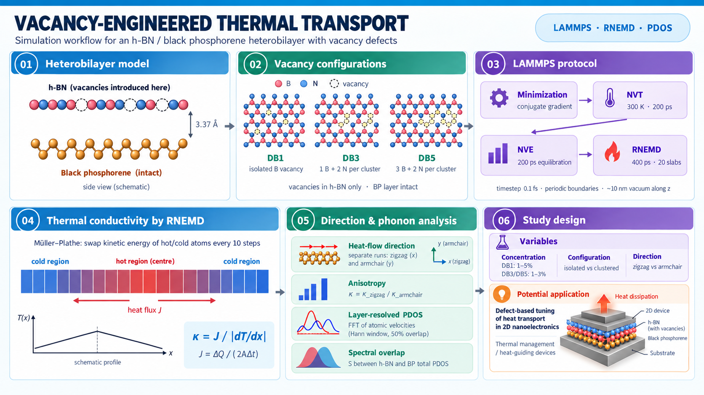

# Vacancy-Engineered Thermal Transport in h-BN/Black Phosphorene Heterobilayers

**Research Project | Computational Materials Science | Nanoscale Thermal Transport**

**Research Areas:** 2D Material Heterostructures | Defect Engineering | Anisotropic Thermal Conductivity | Phonon Density of States

**Simulation Software:** LAMMPS  
**Method:** Reverse Non-Equilibrium Molecular Dynamics (RNEMD), Müller–Plathe Method

---

## Research Overview

This research investigates the effects of vacancy concentration, defect configuration, and heat-flow direction on the in-plane thermal conductivity of hexagonal boron nitride (h-BN)/black phosphorene (BP) heterobilayers using reverse non-equilibrium molecular dynamics simulations in LAMMPS.

Vacancy defects are introduced exclusively into the h-BN layer, while the black phosphorene layer remains intact during initial defect construction.

Three vacancy configurations are investigated:

- **DB1:** Isolated boron monovacancies.
- **DB3:** Three-atom vacancy clusters (1 B + 2 N).
- **DB5:** Five-atom vacancy clusters (3 B + 2 N).

Thermal transport is investigated along the zigzag and armchair directions.

Layer-resolved phonon density of states (PDOS) analysis is employed to investigate vibrational characteristics associated with different vacancy configurations.

The research aims to understand the role of vacancy engineering in controlling anisotropic thermal transport in two-dimensional heterostructures.

---

## Graphical Abstract



*Graphical overview of the heterobilayer model, vacancy configurations, RNEMD methodology, and phonon analysis.*

---

## Representative Heterobilayer Structure

<p align="center">
  
</p>

**Figure:** Top and front views illustrating the atomic arrangement of the h-BN/black phosphorene heterobilayer.

The model consists of an h-BN monolayer stacked above a black phosphorene monolayer. Vacancy defects are introduced within the h-BN layer to investigate defect-dependent thermal transport.

---

## Simulation Methodology

### 1. Heterobilayer Model Construction

The initial h-BN/BP heterobilayer was constructed with approximate in-plane dimensions of 9.3 × 9.3 nm and an initial interlayer separation of 3.37 Å.

Different isolated and clustered vacancy configurations were generated by selectively removing B and N atoms from the h-BN layer.

### 2. Interatomic Potentials

The simulations employ:

- **Tersoff potential:** Intralayer atomic interactions within h-BN.
- **Stillinger–Weber potential:** Intralayer interactions within black phosphorene.
- **Lennard-Jones potential:** Interlayer interactions between h-BN and BP.

### 3. Energy Minimization and Equilibration

Initial atomic configurations undergo conjugate-gradient energy minimization.

The systems are subsequently equilibrated using NVT and NVE molecular dynamics ensembles.

### 4. Thermal Conductivity Calculation

In-plane thermal conductivity is investigated using the Müller–Plathe reverse non-equilibrium molecular dynamics method.

Kinetic energy exchange between selected regions establishes a temperature gradient along the transport direction.

Thermal conductivity is determined using Fourier's law:

```math
\kappa = \frac{J}{\left|\frac{dT}{dl}\right|}
```

### 5. Phonon Density of States Analysis

Layer-resolved PDOS is calculated by processing atomic velocity trajectories obtained from molecular dynamics simulations.

Fourier-based spectral analysis is used to investigate the vibrational characteristics of the h-BN and BP layers.

---

## Research Files


| Research Materials | Description | Access |
|---|---|---|
| **LAMMPS RNEMD Simulation Code** | Energy minimization, equilibration, and Müller–Plathe RNEMD simulations | [Explore Simulation Code →](MD%20simulation%20Code/) |
| **Pristine and Vacancy-Defected Heterobilayer Structures** | LAMMPS data files for pristine, DB1, DB3, and DB5 configurations | [Explore Simulation Data →](Data%20file/) |
| **Interatomic Potentials** | Tersoff potential for h-BN and Stillinger–Weber potential for black phosphorene | [View Force Fields →](Force_field/) |
| **Python: Layer-Resolved PDOS Analysis** | Atomic velocity processing and FFT-based phonon density of states analysis | [Explore Python Analysis Code →](PDOS%20Analysis/) |


---

## Featured Python Tool: Layer-Resolved Phonon Density of States Analysis

**[Explore Python PDOS Analysis Tool →](PDOS%20Analysis/)**

**[View Python Source Code →](PDOS%20Analysis/pdos_analysis.py)**

This Python script processes atomic velocity trajectories generated from LAMMPS molecular dynamics simulations to calculate layer-resolved phonon density of states (PDOS) for h-BN/black phosphorene heterobilayers.

The analysis enables separate examination of the vibrational characteristics of the h-BN and BP layers.

### Key Functionalities

- Processing atomic velocity trajectories generated by LAMMPS.
- Extracting velocity components along the x, y, and z directions.
- Separating atomic velocity data for individual material layers.
- Dividing velocity trajectories into overlapping segments.
- Applying Hann windowing for spectral processing.
- Performing fast Fourier transform (FFT) calculations.
- Averaging spectral contributions across atoms and trajectory segments.
- Exporting processed spectral data for subsequent PDOS analysis.

**Programming Language:** Python

**Analysis Method:** FFT-Based Atomic Velocity Spectral Analysis

**Application:** Vibrational characterization of pristine and vacancy-engineered h-BN/BP heterobilayers.

**Technical Note:** The Python script includes simulation-specific input paths and processing parameters that require adjustment for different datasets.

---

## Computational Analysis Workflow

The research follows the computational workflow outlined below:

1. **Heterobilayer Construction:** Prepare atomistic models of h-BN and black phosphorene layers.
2. **Vacancy Engineering:** Introduce isolated and clustered vacancy defects into the h-BN layer.
3. **Energy Minimization and Equilibration:** Relax and equilibrate the atomistic configurations.
4. **RNEMD Simulation:** Establish a heat flux using the Müller–Plathe algorithm.
5. **Thermal Transport Evaluation:** Calculate temperature gradients and in-plane thermal conductivity.
6. **PDOS Analysis:** Process atomic velocity trajectories to examine layer-resolved vibrational characteristics.

Numerical results and detailed comparative findings are not included while the manuscript is in preparation.

---

## Research Status

**Manuscript:** In preparation.

This repository documents the research methodology and supporting computational tools. Numerical results and comparative thermal conductivity data are being withheld while the manuscript is in preparation.

---

## Contact

**Mostafijur Rahaman**  
Department of Mechanical Engineering  
Bangladesh University of Engineering and Technology (BUET)  
Dhaka, Bangladesh

**Email:** [mostafijur.rahaman.buet@gmail.com](mailto:mostafijur.rahaman.buet@gmail.com)
