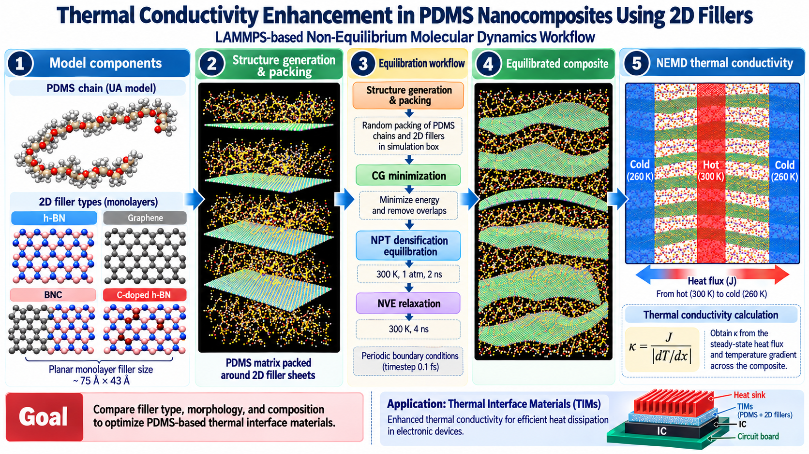
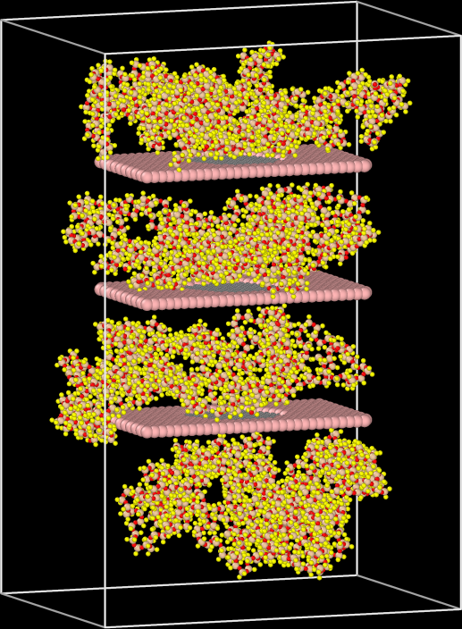

# Thermal Conductivity Enhancement in PDMS-Based Nanocomposites with 2D Fillers

**Undergraduate Thesis | Mechanical Engineering | BUET**

**Research Area:** Nanoscale Thermal Transport | Polymer Nanocomposites | Thermal Interface Materials

**Simulation Software:** LAMMPS  
**Method:** Non-Equilibrium Molecular Dynamics (NEMD)

---

## Research Overview

This research investigates the effects of filler composition, volume fraction, and morphology on the thermal conductivity of polydimethylsiloxane (PDMS)-based nanocomposites using molecular dynamics simulations in LAMMPS.

Four types of two-dimensional fillers are considered:

- Hexagonal boron nitride (h-BN)
- Graphene
- Graphene/h-BN in-plane hybrid heterostructures (BNC)
- Carbon-doped h-BN

Both united-atom (UA) and all-atom (OPLS-AA) representations of PDMS were considered during the preliminary investigation. The hybrid UA model was selected for subsequent investigations because of its reduced computational cost.

The study examines how filler loading, internal composition, and geometric configuration influence thermal transport, with the objective of identifying promising nanocomposite designs for thermal interface material (TIM) applications.

---

## Graphical Abstract



*Graphical overview of the molecular dynamics workflow for investigating thermal transport in PDMS nanocomposites containing two-dimensional fillers.*

---

## Representative Molecular Structure

<p align="center">
  
</p>

**Figure:** Representative atomistic configuration of a PDMS-based nanocomposite containing graphene/h-BN hybrid filler sheets with circular graphene domains.

The composite consists of three planar filler sheets embedded within a PDMS matrix, with polymer chains distributed between and around the filler layers.

---

## Simulation Methodology

### 1. Model Construction

The initial molecular structures were generated using molecular modeling tools and packed using PACKMOL.

The investigated systems consist of PDMS polymer chains and aligned two-dimensional filler sheets.

For the comparative study at 9% filler volume fraction, three filler sheets were placed parallel to the XY plane and separated along the z-direction.

### 2. Interatomic Potentials

The molecular interactions were modeled using:

- **Tersoff potential:** Covalent interactions within h-BN, graphene, and BNC fillers.
- **Hybrid UA / OPLS-AA force fields:** Molecular interactions within PDMS.
- **Lennard-Jones potential:** Nonbonded interactions between PDMS and filler sheets.
- **PPPM method:** Long-range Coulombic interactions.

### 3. Energy Minimization and Equilibration

The initial composite structures were relaxed using conjugate-gradient energy minimization to remove unfavorable atomic contacts.

The systems were subsequently equilibrated using temperature- and pressure-controlled molecular dynamics simulations.

The equilibration procedure includes NPT densification followed by NVE relaxation.


### 4. Thermal Conductivity Calculation

The effective thermal conductivity of the PDMS-based nanocomposites was calculated using non-equilibrium molecular dynamics (NEMD) simulations in LAMMPS.

A hot region (300 K) was placed at the center of the simulation domain, while two cold regions (260 K) were positioned at opposite ends along the x-direction.


The steady-state thermal conductivity was calculated using Fourier's law:

```math
\kappa = \frac{J}{\left|\frac{dT}{dx}\right|}
```

where:

- **κ** = Effective thermal conductivity (W m⁻¹ K⁻¹).
- **J** = Steady-state heat flux (W m⁻²).
- **dT/dx** = Temperature gradient (K m⁻¹).

The heat flux was calculated from the energy transfer rate:

```math
J = \frac{1}{2A}\frac{dE}{dt}
```

The cross-sectional area perpendicular to the heat-flow direction was calculated as:

```math
A = L_y L_z
```

The factor of two accounts for heat flow in two opposite directions from the central hot region under periodic boundary conditions.


The temperature gradient was obtained by linear fitting of the steady-state temperature profiles on both sides of the hot region. The average magnitude of the two fitted slopes was used to calculate the thermal conductivity.


## Research Files

This repository provides the molecular structures, LAMMPS simulation scripts, interatomic potentials, and Python tools used for molecular structure preparation and NEMD data analysis.

| Research Materials | Description | Access |
|---|---|---|
| **LAMMPS Simulation Scripts** | Energy minimization, NPT equilibration, and NEMD thermal conductivity simulations | [Explore Simulation Codes →](MD%20code/) |
| **Molecular Structures & Simulation Data** | PDB structures and LAMMPS molecular data files | [Explore Simulation Data →](Data%20file/) |
| **Interatomic Potential** | B–N–C Tersoff potential parameters | [View Force Field →](Force%20field/) |
| **Python: Molecular Structure Data file Preparation from PDB file** | PDB-to-LAMMPS conversion and molecular topology generation | [Explore Python Code →](Structure%20Preparation/) |
| **Python: NEMD Thermal Transport Analysis** | Temperature-profile and thermostat energy-exchange data processing | [Explore Analysis Codes →](Analysis%20Code/) |

---

## Featured Python Tools

The following Python scripts were used for molecular structure preparation and post-processing of LAMMPS simulation outputs.

### 1. Python-Based Molecular Structure Preparation and Topology Generation

**[View Python Source Code →](Structure%20Preparation/pdb_to_lammps_data.py)**

**[Explore Structure Preparation Documentation →](Structure%20Preparation/)**

This Python script processes molecular structures in PDB format and generates LAMMPS-compatible data files for molecular dynamics simulations.

**Key Functionalities:**

- Processing atomic coordinates from PDB files.
- Identifying PDMS and two-dimensional filler atoms.
- Assigning atom types, masses, and partial charges.
- Constructing molecular topology, including bonds, angles, and dihedrals.
- Defining simulation box dimensions.
- Generating LAMMPS data files for subsequent molecular dynamics simulations.

**Programming Language:** Python

**Libraries:** MDAnalysis, NumPy

**Technical Note:** The script uses structure-specific atom-numbering assumptions and predefined input settings.

---

### 2. Python-Based NEMD Temperature Profile and Heat Flux Data Analysis

**[Explore Python Analysis Tools →](Analysis%20Code/)**

These scripts process spatial temperature and thermostat energy-exchange data generated during non-equilibrium molecular dynamics simulations.

#### A. Temperature Profile Processing

**[View Temperature Profile Python Code →](Analysis%20Code/Temperature_Profile.py)**

This script processes spatially resolved temperature data from LAMMPS simulation outputs.

**Key Functionalities:**

- Reading LAMMPS temperature-profile output files.
- Selecting simulation data within specified timestep intervals.
- Extracting temperature values from individual spatial bins.
- Calculating time-averaged temperatures for each spatial bin.
- Preparing temperature data for profile visualization and subsequent temperature-gradient calculations.

#### B. Heat Flux Data Processing

**[View Heat Flux Python Code →](Analysis%20Code/Flux_Profile.py)**

This script extracts and filters thermostat energy-exchange data generated during NEMD simulations.

**Key Functionalities:**

- Reading thermostat energy-exchange output files.
- Filtering data over selected timestep intervals.
- Extracting energy-exchange information from hot and cold regions.
- Exporting processed data to Excel format.
- Preparing energy-exchange data for subsequent heat-flux calculations.

**Programming Language:** Python

**Libraries:** Pandas, OpenPyXL

---

## Thermal Transport Analysis Workflow

The post-processing workflow consists of the following stages:

1. **Temperature Profile Extraction:** Calculate time-averaged temperatures across spatial bins.
2. **Temperature Gradient Analysis:** Determine the temperature gradient by linear fitting of steady-state temperature profiles.
3. **Energy-Exchange Analysis:** Extract thermostat energy-exchange data over the selected steady-state interval.
4. **Heat Flux Evaluation:** Calculate heat flux from the energy transfer rate and cross-sectional area.
5. **Thermal Conductivity Calculation:** Determine effective thermal conductivity using Fourier's law.

The uploaded Python scripts perform temperature and energy-exchange data extraction and averaging. The subsequent gradient fitting, heat-flux evaluation, and thermal conductivity calculations require additional post-processing.

---

## Conference Presentation

**Title:** Molecular Dynamics Study of Thermal Conductivity Enhancement in PDMS Nanocomposites Using H-BN Based Fillers

**Conference:** ASME International Mechanical Engineering Congress and Exposition (IMECE 2026)

**Paper Number:** 198871

**Status:** Technical presentation accepted.

[**View Official Conference Abstract →**](https://imece.secure-platform.com/a/solicitations/281/sessiongallery/24922/application/198871)

**Presentation Slides:** To be uploaded after the conference presentation.

---

## Research Status

**Manuscript:** In preparation.

Simulation codes, supporting data, and analysis scripts are being organized for research documentation and reproducibility.

---

## Authors

**1. Mostafijur Rahaman**  
Department of Mechanical Engineering  
Bangladesh University of Engineering and Technology (BUET), Dhaka, Bangladesh  
*First Author*

**2. Arman Hassan**  
Department of Mechanical Engineering  
Bangladesh University of Engineering and Technology (BUET), Dhaka, Bangladesh  
*Co-Author*

**3. Prof. Dr. Md. Ashiqur Rahman**  
Department of Mechanical Engineering  
Bangladesh University of Engineering and Technology (BUET), Dhaka, Bangladesh  
*Corresponding Author*

---

## Contact

**Mostafijur Rahaman**  
Department of Mechanical Engineering  
Bangladesh University of Engineering and Technology (BUET)

**Email:** [mostafijur.rahaman.buet@gmail.com](mailto:mostafijur.rahaman.buet@gmail.com)
